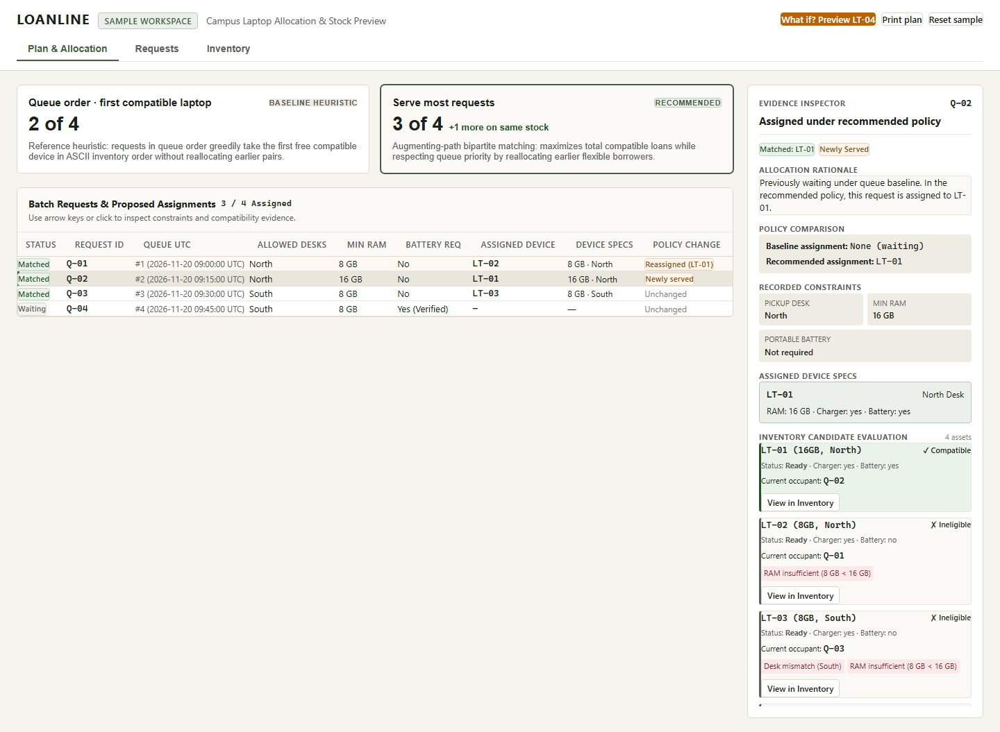
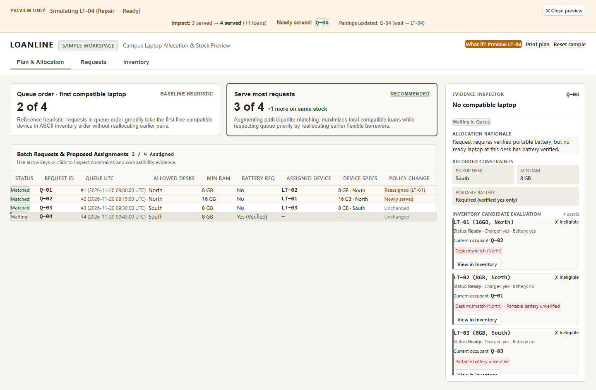
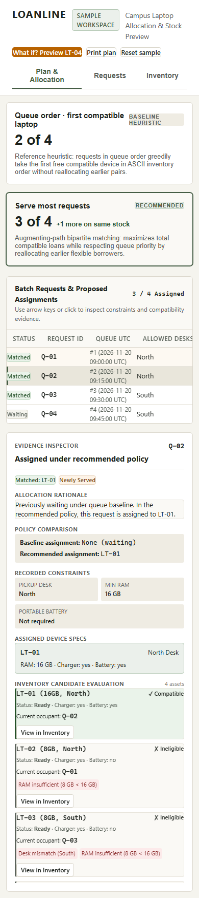

# Loanline

**A browser-based planning tool for campus laptop lending desks: see who can borrow a laptop, why anyone is left waiting, and which stock change would help.**



---

## The One-Minute Problem & The Reveal

Campus laptop lending programs operate on limited, heterogeneous refurbished inventory across multiple pickup locations. When volunteer coordinators assign laptops greedily in arrival order, flexible borrowers often consume high-specification machines, leaving subsequent students with specialized needs stranded without equipment.

### The Competition Benchmark Reveal:
- **Arrival Order Baseline**: The oldest request (`Q-01`, 8 GB min at North) greedily takes the first matching laptop (`LT-01`, 16 GB). The next request (`Q-02`, 16 GB min at North) is left waiting because no other 16 GB laptop exists. Result: **2 of 4 requests served**.
- **Loanline Recommended Matching**: Reassigns `Q-01` to `LT-02` (8 GB) and allocates `LT-01` (16 GB) to `Q-02`. Both students are served. Result: **3 of 4 requests served on the exact same stock**.
- **"What if?" Stock Preview**: Request `Q-04` still waits because South desk's `LT-03` lacks verified battery and `LT-04` is in repair. By simulating completing repair on `LT-04`, Loanline shows that a 4th loan is instantly unlocked (**4 of 4 requests served**).



---

## Key Features

- **Dual-Policy Comparison**: Side-by-side comparison of arrival order first-fit vs. maximum-cardinality augmenting-path matching.
- **Evidence Inspector**: Explains every assignment or waitlist status using tested, structured reason codes (`MATCHED_REASSIGNED`, `WAITING_NO_COMPATIBLE`, `WAITING_COMPETITION`).
- **Non-Mutating "What If?" Preview**: Test the impact of repairing held laptops on an in-memory clone without altering saved state.
- **Privacy-Preserving Architecture**: Zero personally identifiable information (no names, emails, phone numbers, or income records). Data is stored locally in the browser profile via versioned `localStorage`.
- **Review-Ready Printing**: CSS print rules (`@media print`) format an official allocation proposal for volunteer desk handoff, clearly marked as *"PROPOSED ASSIGNMENT FOR REVIEW · NON-FINAL"*.
- **Responsive Mobile Layout**: Fully usable at 390 px mobile viewports for floor volunteers with handheld devices.



---

## Quick Setup & Verification

### Prerequisites
- Node.js LTS (v20+ or v22+)
- npm (v10+ or v11+)

### Installation & Local Run
```bash
# Clone the repository
git clone <repository-url>
cd Code_For_Change

# Install pinned dependencies
npm ci

# Start local development server
npm run dev
```

### Complete Verification Suite
```bash
# 1. TypeScript static typechecking (zero errors)
npm run typecheck

# 2. Run unit tests and brute-force oracle verification (48 tests)
npm test

# 3. Production build
npm run build

# 4. Playwright E2E browser automation (desktop 1440x900 & mobile 390px)
npm run test:e2e
```

---

## Architecture Overview

```
src/
├── types/
│   └── domain.ts            # Core domain contracts (LoanRequest, LaptopAsset, Policies)
├── domain/
│   ├── compatibility.ts     # Pure TypeScript compatibility predicate & reason codes
│   ├── allocator.ts         # Baseline heuristic & augmenting-path bipartite matcher
│   ├── inspector.ts         # Rationale generation & non-mutating repair preview simulator
│   └── sampleData.ts        # Canonical golden benchmark fixture
├── storage/
│   └── storage.ts           # Versioned localStorage persistence & corruption fallback
├── components/
│   ├── Header.tsx           # Brand, mode badge, and top navigation
│   ├── PolicyComparison.tsx # Dual policy comparison cards
│   ├── PlanView.tsx         # Main allocation table & print proposal container
│   ├── RequestsView.tsx     # Privacy-first request management form & table
│   ├── InventoryView.tsx    # Refurbished stock tracker with verification flags
│   ├── Inspector.tsx        # 340 px evidence and constraint inspector panel
│   ├── RepairPreviewDrawer.tsx # Amber non-mutating repair preview banner
│   └── ConfirmModal.tsx     # Accessible confirmation dialog with focus trap
├── styles/
│   ├── variables.css        # Rhythm Sanghi warm utility design tokens
│   ├── main.css             # Component layout, table rules, and 390px responsiveness
│   └── print.css            # Clean black-and-white print proposal stylesheet
└── test/
    ├── compatibility.test.ts # Edge condition and multi-constraint unit tests
    ├── allocator.test.ts     # Golden sample, multi-hop chains, tie-breaking
    ├── inspector.test.ts     # Structured rationale codes & preview non-mutation
    ├── storage.test.ts       # Serialization, schema validation, corruption recovery
    └── oracle.test.ts        # Seeded exponential brute-force oracle (15 trials)
```

---

## Policy Limitations & Operational Scope

1. **Advisory Proposals**: Allocation results are proposals for human coordinator review. Device distribution still requires physical equipment handoff and visual asset checks.
2. **Snapshot Accuracy**: Allocator quality depends on accurate inventory records. An unrecorded hardware defect will invalidate an assignment until corrected.
3. **Queue Prioritization**: Loanline uses queue arrival order (broken deterministically by request ID) as the tie-breaker. A campus program can adapt the priority order based on academic or need-based criteria.
4. **Local Browser Isolation**: All data is local to the coordinator's browser profile. No cloud accounts or network sync are used.

---

## Documentation Links

- **[docs/algorithm.md](docs/algorithm.md)**: Formal mathematical specification, transversal matroid proof sketch, worked sample, and guarantees.
- **[docs/demo.md](docs/demo.md)**: 75–90 second click-by-click presentation script with operator actions and spoken narration.
- **[docs/devpost.md](docs/devpost.md)**: Complete Devpost hackathon project submission draft mapped to judging criteria.
- **[docs/credits.md](docs/credits.md)**: Contributor attribution, factual record of AI assistance, and design references.

---

## License

MIT License. See [package.json](package.json).
